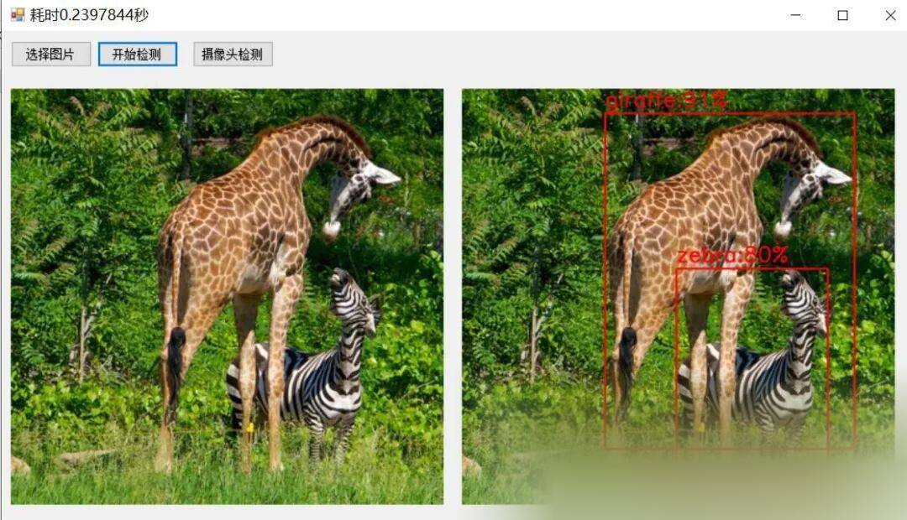

# [C#] C# Winform Deployment of ONNX Model for YOLOv11 Object Detection

[Test Environment]

vs2019

netframework4.7.2

opencvsharp4.8.0

onnxruntime==1.16.2

[Effect Display]



[Implementation of Partial Code]

-
-
-
-
-
-
-
-
-
-
-
-
-
-
-
-
-
-
-
-
-
-
-
-
-
-
-
-
-
-
-
-
-
-
-
-
-
-
-
-
-
-
-
-
-
-
-
-
-
-
-
-
-
-
-
-
-
-
-
-
-
-
-
-
-
-
-
-
-
-
-
-
-
-
-
-
-
-
-
-
-
-
-
-
-
-
-
-
-
-
-
-
-
-
-
-
-
-
-
-
-
-
-

```
using System;using System.Collections.Generic;using System.ComponentModel;using System.Data;using System.Diagnostics;using System.Drawing;using System.Linq;using System.Text;using System.Threading.Tasks;using System.Windows.Forms;using OpenCvSharp; namespace FIRC{    public partial class Form1 : Form    {        Mat src = new Mat();        Yolov11Manager ym = new Yolov11Manager();        public Form1()        {            InitializeComponent();        }         private void button1_Click(object sender, EventArgs e)        {            OpenFileDialog openFileDialog = new OpenFileDialog();            openFileDialog.Filter = "Figure files(*.*)|*.jpg;*.png;*.jpeg;*.bmp";            openFileDialog.RestoreDirectory = true;            openFileDialog.Multiselect = false;            if (openFileDialog.ShowDialog() == DialogResult.OK)            {                              src = Cv2.ImRead(openFileDialog.FileName);                pictureBox1.Image = OpenCvSharp.Extensions.BitmapConverter.ToBitmap(src);              }          }         private void button2_Click(object sender, EventArgs e)        {            if(pictureBox1.Image==null)            {                return;            }            Stopwatch sw = new Stopwatch();            sw.Start();            var result = ym.Inference(src);            sw.Stop();            this.Text = "Time-consuming" + sw.Elapsed.TotalSeconds + "Second";            var resultMat = ym.DrawImage(result,src);            pictureBox2.Image= OpenCvSharp.Extensions.BitmapConverter.ToBitmap(resultMat); //MatTranslateBitmap        }         private void Form1_Load(object sender, EventArgs e)        {            ym.LoadWeights(Application.StartupPath+ "\\weights\\yolo11n.onnx", Application.StartupPath + "\\weights\\labels.txt");         }         private void btn_video_Click(object sender, EventArgs e)        {            var detector = new Yolov11Manager();            detector.LoadWeights(Application.StartupPath + "\\weights\\yolov10n.onnx", Application.StartupPath + "\\weights\\labels.txt");            VideoCapture capture = new VideoCapture(0);            if (!capture.IsOpened())            {                Console.WriteLine("video not open!");                return;            }            Mat frame = new Mat();            var sw = new Stopwatch();            int fps = 0;            while (true)            {                 capture.Read(frame);                if (frame.Empty())                {                    Console.WriteLine("data is empty!");                    break;                }                sw.Start();                var result = detector.Inference(frame);                var resultImg = detector.DrawImage(result,frame);                sw.Stop();                fps = Convert.ToInt32(1 / sw.Elapsed.TotalSeconds);                sw.Reset();                Cv2.PutText(resultImg, "FPS=" + fps, new OpenCvSharp.Point(30, 30), HersheyFonts.HersheyComplex, 1.0, new Scalar(255, 0, 0), 3);                //Display results                Cv2.ImShow("Result", resultImg);                int key = Cv2.WaitKey(10);                if (key == 27)                    break;            }             capture.Release();          }    }}
```

[Running Steps]

(1) First, install the YOLOv8 environment according to the official installation tutorial or other website's installation guide.

(2) Download the model: https://github.com/ultralytics/assets/releases/download/v8.3.0/yolo11n.pt
(3) Export the ONNX model: yolo export model=yolo11n.pt format=onnx dynamic=False opset=12
(4) Then, put the yolo11.onnx model into FIRC\bin\x64\Debug\weights
Finally, run the project and select x64 Debug to proceed. Since the initial run may encounter errors, if an error occurs, please refer to https://blog.csdn.net/FL1623863129/article/details/135424751
Solution

[Complete Source Code Download]


## Payment

Here is a pay link on Stripe ( https://buy.stripe.com/3cs8yP7sY87d0vu9AB ). Please contact me lonlonago@foxmail.com after funding $89, and I will send you a complete data files , thank you!


